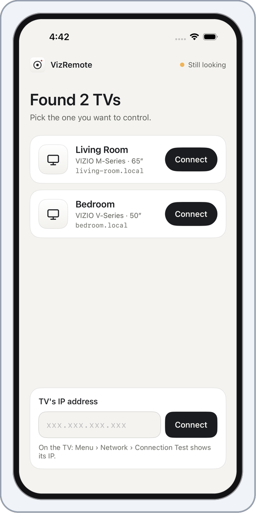
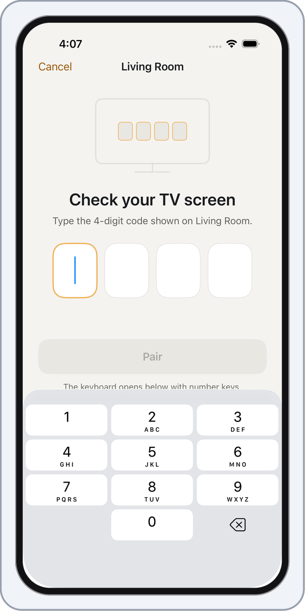
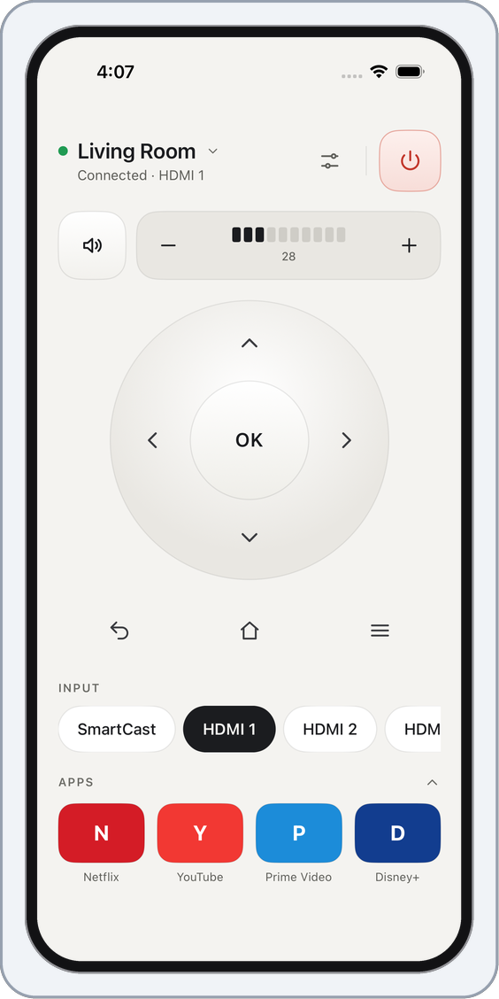
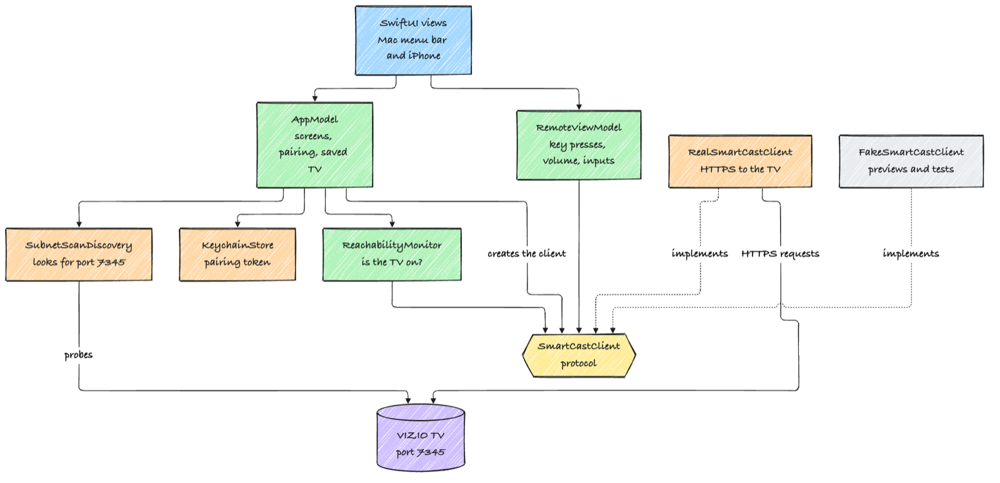

<div align="center">

# VizRemote

An unofficial remote control for VIZIO SmartCast TVs, for your Mac and your iPhone.


<br>


&emsp;&emsp;

&emsp;&emsp;


<sub>The iPhone app, shown with sample data.</sub>

</div>

## About

VizRemote talks straight to your TV over your home network. There is no account, no cloud service and no tracking. The Mac app sits in the menu bar, and the iPhone app is the same remote in your pocket.

It is not made by VIZIO. VIZIO and SmartCast are trademarks of VIZIO, Inc., and this project is not affiliated with or endorsed by them. The app shortcuts use plain colored tiles with a letter, not the streaming services' logos.

## Features

- Finds your TV on the local network, or you can type its IP address.
- Pairs with the 4-digit code the TV shows. The token it gets back is kept in the Keychain.
- Power, volume and mute, a direction pad with OK, back, home and menu, input switching, and shortcuts for Netflix, YouTube, Prime Video and Disney+.
- Shows a "TV is off" screen when the TV can't be reached.
- Light, dark or system appearance.

## Getting started

You need a recent Xcode. The apps target macOS 14 and iOS 17.

```bash
git clone https://github.com/makambo13/VizRemote.git
cd VizRemote
open VizRemote.xcodeproj
```

Choose the `VizRemote` scheme for the Mac app or `VizRemoteiOS` for the iPhone app, pick your own team under Signing, and run it. The bundle IDs are `com.example.*`. Change them in `project.yml` and run `xcodegen generate` ([XcodeGen](https://github.com/yonaskolb/XcodeGen) builds the Xcode project from that file).

## Using it

1. Open the app and allow access to the local network when it asks. The TV must be on the same Wi-Fi network.
2. Pick your TV from the list. If it isn't listed, type its IP address (on the TV: Menu, Network, Connection Test).
3. Type the 4-digit code the TV shows on screen.

After that the remote opens, and the app reconnects to the same TV next time.

## How it works

VIZIO doesn't publish the API, so this follows the community [pyvizio](https://github.com/raman325/pyvizio) project. The TV runs a small HTTPS service on port 7345 with a self-signed certificate, which the app accepts for the TV's address only. Everything the app asks of the TV goes through the `SmartCastClient` protocol, so tests and previews use a fake TV instead of a real one.

<p align="center">
  
</p>

## Tests

There are 84 unit tests, shared by the Mac and iPhone apps. Run them with ⌘U in Xcode, or:

```bash
fastlane ci
```

That runs the tests and builds for both apps. For the iPhone app it picks an installed iPhone simulator. To choose one yourself, set `IOS_SIMULATOR_DESTINATION`, for example `id=<simulator id>`.

## Releasing

The `Jenkinsfile` runs `fastlane ci`. The lanes that upload to the App Store need a paid Apple Developer Program membership and a `fastlane/Appfile` (copy `fastlane/Appfile.example`). The app is not on the App Store yet.

## Limits and help

It was built against one real TV. VIZIO doesn't document the API, so other models or firmware may behave differently. If something doesn't work, please open an issue on GitHub.
